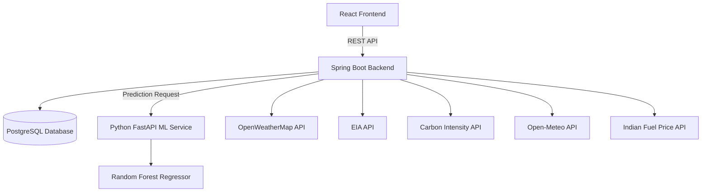

# ⚡ EnergyAI — Energy Crisis Intelligence Platform

EnergyAI is a full-stack web application for monitoring energy-related information, storing energy data, displaying energy analytics, retrieving external energy and environmental data, and generating AI-based energy predictions.

The application combines a **React frontend**, **Spring Boot backend**, **PostgreSQL database**, and a separate **Python FastAPI machine-learning service**.

The platform provides a dashboard where users can view energy records, weather information, renewable-energy indicators, carbon intensity, fuel prices, natural-gas prices, and AI-generated energy predictions.

---

## ✨ Features

### ⚡ Energy Data Management

* Add energy data including:

  * Region
  * Energy consumption
  * Fuel price
  * Demand
  * Supply
  * Crisis severity
* Store energy records in PostgreSQL.
* Retrieve stored energy records.
* Display energy information through the dashboard.

### 🤖 AI Energy Prediction

The project contains a separate Python-based prediction service using:

* Python
* FastAPI
* NumPy
* scikit-learn
* Random Forest Regression

The prediction service accepts:

```text
Demand
Supply
```

and returns:

```text
Predicted Consumption
Crisis Severity
```

The current crisis classification logic is:

```text
If demand > supply
        ↓
Crisis Severity = HIGH

Otherwise
        ↓
Crisis Severity = LOW
```

### 🌦️ Weather Information

The backend integrates with the **OpenWeatherMap API** to retrieve:

* Current weather
* Temperature
* Humidity
* Weather conditions
* Weather forecasts

### ⛽ Energy and Fuel Information

The application retrieves:

* Natural-gas price information through the EIA API
* Brent crude data through the EIA API
* Petrol prices for selected cities
* Diesel prices for selected cities

### 🌱 Environmental and Renewable-Energy Information

The dashboard retrieves:

* Carbon intensity
* Solar radiation information
* Wind-speed information

Solar and wind information are obtained through the Open-Meteo API.

### 📊 Dashboard and Analytics

The React dashboard provides:

* Energy analytics
* Energy records
* AI prediction information
* Energy-status indicators
* Weather information
* Weather forecast
* Carbon intensity
* Solar potential information
* Wind information
* Fuel-price information
* Charts and visualizations
* Energy crisis indicators

### 👤 User Management

The application provides:

* User registration
* Admin registration
* User login
* Role information
* JWT token generation

### 🚨 Energy Issue Reporting

Users can report energy-related issues.

The application supports:

* Reporting an issue
* Viewing reported issues
* Viewing issue status
* Resolving issues through the admin interface

---

# 🏗️ Architecture



---

# 🔄 Application Flow

```text
                    User
                     │
                     ▼
              React Frontend
                     │
                     │ REST API
                     ▼
             Spring Boot Backend
                │     │      │
        ┌───────┘     │      └───────────────┐
        ▼              ▼                      ▼
   PostgreSQL     External APIs        Python ML Service
                                                │
                                                ▼
                                      Random Forest Model
                                                │
                                                ▼
                                      Prediction Response
                                                │
                                                ▼
                                         React Dashboard
```

---

# 🛠️ Technology Stack

## Frontend

* React 19
* React Router
* Axios
* Recharts
* React Gauge Chart
* React Icons
* Lucide React
* JavaScript
* CSS

## Backend

* Java 17
* Spring Boot
* Spring Web MVC
* Spring Data JPA
* Spring Security
* JWT
* Lombok
* Maven

## Database

* PostgreSQL

## Machine Learning Service

* Python
* FastAPI
* Pydantic
* NumPy
* scikit-learn
* RandomForestRegressor

## External APIs

* OpenWeatherMap
* U.S. Energy Information Administration (EIA)
* Carbon Intensity API
* Open-Meteo
* Indian fuel-price API

---

# 📂 Project Structure

```text
energyplatform/
│
├── frontend/
│   ├── public/
│   ├── src/
│   │   ├── components/
│   │   │   ├── AddEnergy.js
│   │   │   ├── AdminIssues.js
│   │   │   ├── Dashboard.js
│   │   │   ├── Login.js
│   │   │   ├── MyIssues.js
│   │   │   ├── NewDashboard.js
│   │   │   ├── Register.js
│   │   │   ├── ReportIssue.js
│   │   │   └── UserDashboard.js
│   │   │
│   │   ├── App.js
│   │   └── index.js
│   │
│   ├── package.json
│   └── package-lock.json
│
├── ml-service/
│   └── main.py
│
├── src/
│   ├── main/
│   │   ├── java/
│   │   │   └── com/energy/energyplatform/
│   │   │       ├── config/
│   │   │       ├── controller/
│   │   │       ├── model/
│   │   │       ├── repository/
│   │   │       ├── security/
│   │   │       └── service/
│   │   │
│   │   └── resources/
│   │       └── application.properties
│   │
│   └── test/
│
├── pom.xml
├── package.json
├── mvnw
├── mvnw.cmd
├── .gitignore
└── README.md
```

---

# 🧩 Backend Components

The Spring Boot backend is organized into controllers, services, repositories, models, and security components.

### Controllers

The project contains controllers for:

```text
/api/auth
/api/energy
/api/issues
/api/weather
/api/eia
/api/carbon
/api/fuel
/api/solar
/api/wind
```

### Services

The backend contains services for:

* Energy data
* Energy issues
* User management
* Weather
* EIA data
* Prediction requests

### Database Models

The project contains entities for:

* `User`
* `EnergyData`
* `EnergyIssue`

These entities are persisted using Spring Data JPA and PostgreSQL.

---

# 🤖 Machine Learning Service

The ML service is located in:

```text
ml-service/main.py
```

It is implemented using FastAPI.

## Model

The current implementation uses:

```python
RandomForestRegressor
```

from:

```python
sklearn.ensemble
```

The model receives two input features:

```text
demand
supply
```

and predicts:

```text
predicted_consumption
```

The API additionally calculates:

```text
crisis_severity
```

based on the relationship between demand and supply.

### Prediction API

```http
POST /predict
```

Example request:

```json
{
  "demand": 900,
  "supply": 500
}
```

Example response structure:

```json
{
  "predicted_consumption": 400,
  "crisis_severity": "HIGH"
}
```

The exact prediction value depends on the trained model.

---

# 📡 API Endpoints

## Authentication

### Register User

```http
POST /api/auth/register
```

### Register Admin

```http
POST /api/auth/register-admin
```

### Login

```http
POST /api/auth/login
```

---

## Energy

### Add Energy Data

```http
POST /api/energy/add
```

This endpoint:

1. Saves the energy data to PostgreSQL.
2. Sends demand and supply to the ML service.
3. Returns the saved data and prediction information.

### Get Energy Data

```http
GET /api/energy/all
```

---

## Energy Issues

### Report Issue

```http
POST /api/issues/report
```

### Get All Issues

```http
GET /api/issues/all
```

### Resolve Issue

```http
PUT /api/issues/resolve/{id}
```

---

## Weather

### Current Weather

```http
GET /api/weather/{city}
```

### Weather Forecast

```http
GET /api/weather/forecast/{city}
```

---

## EIA

### Test EIA API

```http
GET /api/eia/test
```

### Brent Data

```http
GET /api/eia/brent
```

### Natural Gas Price

```http
GET /api/eia/natural-gas-price
```

---

## Carbon

```http
GET /api/carbon
```

---

## Fuel

### Available Cities

```http
GET /api/fuel/cities
```

### Petrol Price

```http
GET /api/fuel/petrol/{city}
```

### Diesel Price

```http
GET /api/fuel/diesel/{city}
```

---

## Solar

```http
GET /api/solar/{city}
```

---

## Wind

```http
GET /api/wind/{city}
```

---

# ⚙️ Prerequisites

Install the following before running the project:

* Java 17
* Node.js
* npm
* Python
* PostgreSQL
* Git

Check the installations:

```bash
java -version
```

```bash
node --version
```

```bash
npm --version
```

```bash
python --version
```

```bash
git --version
```

---

# 🚀 Setup

## 1. Clone the Repository

```bash
git clone https://github.com/samrithi-k/energy_crisis.git
```

Move into the project directory:

```bash
cd energy_crisis
```

If the repository contains the project inside an additional `energyplatform` directory, move into that directory:

```bash
cd energyplatform
```

---

# 2. Configure PostgreSQL

The application uses PostgreSQL.

The configured database is:

```text
energydb
```

Create the database:

```sql
CREATE DATABASE energydb;
```

Then configure the database connection in:

```text
src/main/resources/application.properties
```

Use your own PostgreSQL username and password.

Example:

```properties
spring.datasource.url=jdbc:postgresql://localhost:5432/energydb
spring.datasource.username=YOUR_USERNAME
spring.datasource.password=YOUR_PASSWORD
```

---

# 3. Configure API Keys

The backend uses external APIs that require credentials.

Configure the required API keys securely using environment variables or another secure configuration mechanism.

The repository should **not contain real API keys or secrets**.

Required external services include:

* OpenWeatherMap
* EIA
* Indian fuel-price API

---

# 4. Install Frontend Dependencies

```bash
cd frontend
npm install
```

---

# 5. Configure the Python ML Service

Move into the ML service:

```bash
cd ../ml-service
```

Create a virtual environment:

```bash
python -m venv venv
```

### Windows

```powershell
venv\Scripts\activate
```

### macOS/Linux

```bash
source venv/bin/activate
```

Install the required packages:

```bash
pip install fastapi pydantic numpy scikit-learn
```

---

# 6. Start the ML Service

From:

```text
ml-service/
```

run:

```bash
uvicorn main:app --reload --host 127.0.0.1 --port 8000
```

The prediction service will be available at:

```text
http://127.0.0.1:8000
```

---

# 7. Start the Spring Boot Backend

Open another terminal at the Spring Boot project root.

On Windows:

```powershell
.\mvnw.cmd spring-boot:run
```

The backend uses port:

```text
8080
```

and can be accessed at:

```text
http://localhost:8080
```

---

# 8. Start the React Frontend

Open another terminal:

```bash
cd frontend
```

Install dependencies if necessary:

```bash
npm install
```

Start the application:

```bash
npm start
```

The frontend runs on:

```text
http://localhost:3000
```

---

# 🔐 Authentication Implementation

The backend contains JWT-related components:

```text
security/
├── JwtFilter.java
├── JwtUtil.java
└── SecurityConfig.java
```

The login endpoint generates a JWT containing the user's email.

However, the current implementation permits all HTTP requests in `SecurityConfig`, and the current `JwtFilter` passes requests through without performing token validation.

Therefore, JWT generation is implemented, but **full JWT-based route protection is not currently enforced by the backend**.

---

# 📊 Dashboard

The React dashboard displays information obtained from the backend and external APIs.

The current dashboard includes:

* Energy records
* Energy consumption
* Demand and supply information
* AI prediction information
* Energy-status indicators
* Weather
* Weather forecast
* Carbon intensity
* Solar radiation
* Wind information
* Petrol price
* Natural-gas price
* Energy analytics charts
* Issue reporting

The project contains multiple dashboard components, including:

```text
Dashboard.js
NewDashboard.js
UserDashboard.js
```

---

# 🧪 Testing

The Spring Boot project contains a test:

```text
src/test/java/com/energy/energyplatform/
EnergyplatformApplicationTests.java
```

The test verifies that the Spring application context loads successfully.

Run backend tests with:

```bash
mvn test
```

or on Windows:

```powershell
.\mvnw.cmd test
```

The React application also contains the default React testing setup.

Run frontend tests with:

```bash
cd frontend
npm test
```

---

# ⚠️ Current ML Implementation

The current ML service is a prototype implementation.

The Random Forest model is trained directly in `main.py` using a small hard-coded dataset.

Therefore, the current implementation should be considered a **prototype prediction service**, rather than a production-trained energy forecasting model.

Future development can include:

* Larger real-world energy datasets
* Proper training/validation/test splits
* Feature engineering
* Model evaluation
* Hyperparameter tuning
* Time-series-specific models
* More meaningful crisis prediction
* Model persistence
* Automated model retraining

---

# 🔮 Future Enhancements

Potential improvements include:

* Train the model using a larger real-world energy dataset.
* Add proper ML evaluation metrics.
* Improve crisis classification.
* Implement secure JWT authentication and authorization.
* Move all API keys and secrets to environment variables.
* Add role-based authorization.
* Improve prediction accuracy.
* Add historical forecasting.
* Add anomaly detection.
* Add more energy sources and datasets.
* Improve dashboard analytics.
* Add automated alerts.
* Deploy the application to the cloud.
* Containerize the services using Docker.

---

# 🔒 Security Notice

**Never commit API keys, database passwords, JWT secrets, or other credentials to GitHub.**

Before publishing this project, remove any existing secrets from source files and configuration files and replace them with environment variables or secure secret management.

If a real API key has already been committed to a public or shared repository, **rotate/revoke that key** and replace it with a new one.

---

# 👩‍💻 Project Maintainer

**Samrithi K**

GitHub:

https://github.com/samrithi-k

---

## 📄 Project Status

**Current status:** Academic / prototype implementation

The project currently combines:

```text
React
   ↓
Spring Boot
   ↓
PostgreSQL
   ↓
Python FastAPI
   ↓
Random Forest Prediction
```

with additional external data sources for weather, fuel, natural gas, carbon intensity, solar radiation, and wind information.
